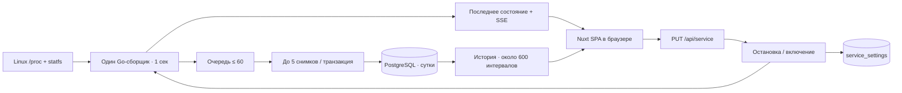

# Архитектура GoInMetrics · v0.2

## Основание

Аналитика «Каримов_ДР_Архитектура_GoInMetrics (1).docx» задаёт один Linux-сервер, секундный сбор, историю за сутки и SSH-доступ. Прямой запрос заказчика заменяет React/SQLite на Nuxt/Vue и PostgreSQL. Последующее уточнение удаляет события, добавляет темы, документацию и выключение мониторинга.

| Решение | Реализация |
|---|---|
| Одна команда | `./start.sh` при установленном Docker Engine 25+ / Compose 2.20.2+; случайный пароль и схема автоматически |
| Небольшие расходы | Прямое чтение Linux, один сборщик, пакетная запись, ограниченные очереди |
| Готовая панель | Nuxt SPA в `go:embed all:public`, без отдельного runtime Node.js |
| Локальные данные | PostgreSQL 17 через Unix-сокет; HTTP только loopback, просмотр по SSH |
| Управление | Сохранённое в PostgreSQL состояние сбора; полное выключение через `./stop.sh` |
| Интерфейс | Две темы, локальный Inter, скрывающийся сайдбар, встроенная документация |

## Поставка и сравнение периодов

Поставка: multiarch-образы amd64/arm64 собираются в CI. Runtime Compose не содержит build; явная разработческая сборка вынесена в compose.build.yaml. Архивы содержат образ приложения, описание платформы, контрольные суммы и загрузчик, а не исходники. Подробности: [releases.md](releases.md).

Сравнение использует два ограниченных запроса к существующей истории (около 600 корзин каждый). Интервалы одинаковой длины, упорядочены и лежат в последних сутках. В БД используются полуоткрытые интервалы, поэтому общая граница не считается дважды. Среднее взвешивается по числу измерений, null исключается с уменьшением покрытия. Оба графика имеют один масштаб. Статистика и визуализация выполняются в браузере; новых циклов сбора нет. Фоновый запрос истории основного обзора при просмотре сравнения отключается.

## Модули

- `collector`: `/proc/stat`, `meminfo`, `net/dev`, `1/mountinfo`, `loadavg`, `statfs`. Никаких subprocess. Обнаружение файловых систем раз в минуту. Ошибка источника не отменяет остальные значения.
- `monitor`: единственный планировщик сбора, последнее состояние, рассылка и один писатель. Метаданные хоста читаются один раз; uptime вычисляется по прошедшему времени.
- `store`: pgxpool до 4 соединений; снимки JSONB и настройка состояния. Идемпотентная схема и вставка по времени, очистка.
- `server`: JSON API, SSE и встроенные файлы. Проверки loopback Host, совпадения Origin, Fetch Metadata; лимит и строгий JSON для управления.
- `web`: Nuxt/Vue/TypeScript, SVG-графики, локальный Inter с OFL. Настройки темы/сайдбара в localStorage, начало темы применяется до отрисовки, внешних CDN-запросов нет.

## Расчёты и качество

CPU — доля не-idle времени между чтениями; iowait считается idle. Guest повторно не добавляется. Память — MemTotal − MemAvailable. Сеть — разница счётчиков / фактический интервал; новый интерфейс и сброс счётчика дают `null`. Loopback/Docker bridge/veth исключены, пересекающиеся VPN/физические интерфейсы могут учитывать тот же трафик. Диск — used/(used+available), с учётом места обычного пользователя; сводка — максимум.

Первое чтение CPU и сети — подготовка. После включения счётчики сбрасываются, чтобы не показывать среднее за время остановки. Ошибки и пропуски явные. UTC хранится в БД; браузер показывает свой часовой пояс.

## Запись и очереди

До пяти снимков одной транзакцией или раз в пять секунд. Таймаут записи 4 секунды. Очередь 60 снимков не растёт без ограничения; переполнение и неудавшиеся пакеты учитываются в dropped. При ошибке БД текущий поток продолжается. Бесконечных повторов и восстановления выдуманных точек нет. Остановка процесса пытается записать остаток с ограниченным таймаутом; аварийное завершение может потерять ещё не записанные секунды.

SSE-зритель имеет очередь на одно последнее обновление. Медленный клиент не блокирует сбор. Обновление включает состояние сервиса; выключение видно всем зрителям. Значение collected позволяет проверить, что число циклов не зависит от числа страниц.

## Остановка

PUT `/api/service` передаёт команду единственному планировщику. При выключении планировщик приостанавливает сбор и ставит FIFO-барьер в очередь писателя. Писатель завершает предыдущие снимки и пакет; затем настройка сохраняется в PostgreSQL. Только после этого подтверждается остановка и рассылается статус. Ошибка сохранения оставляет прежнее состояние. Команды сериализованы; повтор текущего значения не создаёт лишнего измерения.

При выключенном мониторинге не читаются счётчики, не записываются снимки и не выполняется очистка. HTTP, SSE heartbeat и PostgreSQL остаются живыми, что позволяет смотреть историю и снова включать сбор. Это не нулевой расход памяти. После перезапуска настройка читается до запуска планировщика.

Полная остановка: `./stop.sh` останавливает оба контейнера без удаления томов. Повторный запуск: `./start.sh` использует готовый локальный образ; `./start.sh --build` явно пересобирает приложение. Состояние сбора сохраняется независимо от состояния контейнеров.

## Данные

`samples(time PK, data JSONB)` — около 86 400 снимков в сутки при штатном сборе. JSONB повторяет имена ресурсов ради простоты атомарного снимка; фактический размер измеряется, не объявляется заранее. `service_settings(id=1, monitoring_enabled)` — единственное общее состояние.

События и правила удалены из кода, схемы новой установки и API. Таблицы старой версии, если уже существуют, не удаляются разрушительной миграцией и больше не используются. Нумерованные миграции потребуются при дальнейшем развитии схемы.

Очистка раз в минуту удаляет до 10 000 старых снимков за проход. При включённом сборе хранится скользящая история за сутки с задержкой очистки; после долгой остановки очистка догоняет срок несколькими проходами. При выключенном сборе старые строки остаются до возобновления очистки; API всё равно ограничен последними сутками.

История агрегируется примерно в 600 интервалов с avg/min/max и числом точек. Внутренний разрыв или недоступный источник превращает среднюю точку в null; график сохраняет пики и разрывы с разрешением выбранного масштаба. В браузере до 1600 точек, включая ещё не записанный хвост. Переподключение обновляет историю. CSV — показанные средние точки.

## Размещение

Go: UID 65532, cap_drop ALL, no-new-privileges, read-only root. Хостовые `/proc` и `/` монтируются read-only; host network нужен для сетевых счётчиков, host UTS — для hostname. Читается mountinfo PID 1 хоста. Docker Desktop/rootless/hidepid требуют отдельной проверки. Read-only-монтирование `/` всё равно позволяет процессу читать доступные его UID файлы хоста.

PostgreSQL: Unix-сокет, SCRAM-пароль в `.env` 0600, shared_buffers 32 MiB, work_mem 2 MiB, max_connections 20. В рабочем режиме healthcheck выполняется раз в 30 секунд; во время старта — раз в 2 секунды. Это сокращает запуски диагностических процессов на хосте. [Требования Docker к start_interval](https://docs.docker.com/reference/dockerfile/#healthcheck), [поддержка в Compose](https://docs.docker.com/reference/compose-file/services/#healthcheck). Лимиты Go/БД 128/256 MiB — ограничения, не фактические расходы. К одному экземпляру БД подключается один наблюдатель. При старте порт проверяется до подготовки БД.

Существующий SSH выдаёт доступ; роли и регистрация отсутствуют. Все подключённые пользователи могут останавливать общий мониторинг. Полный отказ хоста требует внешней проверки.

[Измерения расходов](performance.md) · [API](api.md)
